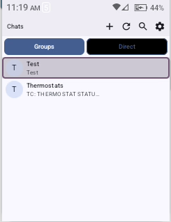
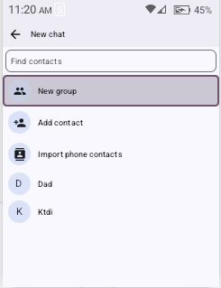
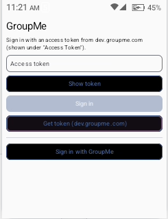

<div align="center">


# GroupMe for Android

**A fast, native GroupMe client built for phones with no touchscreen.**
Flip phones, keypad phones, tiny screens: everything works with a D-pad.


</div>

<table align="center">
  <tr>
    <td align="center"><br><sub><b>Chats</b><br>groups and direct messages</sub></td>
    <td align="center"><br><sub><b>New chat</b><br>find contacts, start a group</sub></td>
    <td align="center"><br><sub><b>Sign in</b><br>token or in-app OAuth</sub></td>
  </tr>
</table>

> Screenshots are from a 240x320 keypad phone. On bigger screens the layout simply gets roomier.

---

## ✨ Features

- 💬 **Groups and direct messages** with message history, sending text and images, and likes
- 🕹️ **Built for D-pad phones**: every screen, dialog and web page is reachable with the arrow keys, OK and Back
- 📱 **Tiny-screen layout** for 240x320 displays (slim bars, compact text, no wasted space)
- ➕ **New chat** like the real app: find contacts, start a group, add people by phone or email
- 📇 **Contacts**: save them by hand or import from the phone's address book
- 🗑️ **Leave or delete chats** (see [Deleting chats](#️-deleting-chats))
- 🔔 **Notifications** with inline reply, mark-as-read, per-chat mute and unread badges
- ⚡ **Live updates** while the app is open, plus background checks when it isn't
- 🔄 **Updates from GitHub Releases**, right inside the app
- 🔐 **Sign in your way**: paste an access token, or use GroupMe's OAuth in an in-app browser

## 🚀 Quick start

1. Download the latest APK from the [Releases](https://github.com/JMTDI/GroupMe/releases) page and install it.
2. Open the app. Choose **Get token (dev.groupme.com)**, log in, and copy your access token, or use **Sign in with GroupMe** if your build has OAuth set up.
3. Paste the token (use **Show token** to check what you typed) and press **Sign in**.

After that the app updates itself from new releases.

## 🕹️ D-pad cheat sheet

| Where | Keys |
| --- | --- |
| **Chat list** | Up/Down move, **OK** opens a chat, **Clear/Delete** removes the focused chat. Top bar: New chat, Refresh, Search, Settings |
| **A chat** | Up/Down move between messages, **OK** opens Like / Open image / Copy text. On very tall messages Up/Down scroll inside them |
| **Message box** | Left/Right move the cursor (at the ends they jump to Attach / Send), **Up** goes to the newest message, **Down** to Send, **OK/Enter** sends |
| **In-app browser** | Arrows jump between links, buttons and fields (orange outline) and scroll when nothing is left, **OK** clicks, **Back** goes back. Allow/Deny pages get real buttons at the bottom |
| **Everywhere** | **Back** always steps out one level |

## 👥 New chats and groups

Press **+** in the chat list.

- **Find contacts** searches people from your groups and chats plus the contacts you saved. Pick a GroupMe user to start a direct message; the chat is created when you send the first message.
- **New group** takes a name and optional description, and adds people from your contacts and/or by phone number or email.
- **Add contact** saves a name with a phone number or email. **Import phone contacts** copies names and numbers from the address book (asks for the Contacts permission).

GroupMe's API can't look people up or message a bare phone number, so saved contacts can be *invited into a group*; picking one starts a new group with them selected. Announcement, Event and Vanishing groups aren't in GroupMe's public API, so they can't be created here.

## 🗑️ Deleting chats

Open a chat and press the trash icon, or focus a chat in the list and press **Clear/Delete** (long-press on a touchscreen). A confirmation always comes first.

| Chat type | What happens |
| --- | --- |
| **Group** | **Leave group** removes you from it. The creator can't leave; they can use **Delete for everyone** instead |
| **Direct message** | GroupMe's API can't delete direct chats, so the chat is **hidden in this app** and its local copy is cleared. The other person keeps theirs, and the chat comes back if either of you sends a new message |

## 🔋 Background messages

Settings → **Messages while the app is closed**:

| Mode | How it works |
| --- | --- |
| **Every 15 minutes** (default) | No persistent notification. Android checks about every 15 minutes (later in battery saver). New messages notify |
| **Instant** | A live connection delivers messages immediately. Android requires a small ongoing notification for it; on Android 13+ you can hide it from the notification settings (there's a shortcut button) |
| **Off** | Nothing runs in the background |

While the app is open you always get live updates.

## 🔄 Updates

The app checks your repository's latest GitHub Release on launch (at most every 12 hours). **Settings** has a toggle and a **Check for updates now** button. When a newer version exists you see the release notes; **Update** downloads the APK, verifies its SHA-256 and opens Android's installer (the first time, Android asks you to allow installing apps from GroupMe).

- Versions come from the tag you give the release workflow (`v1.8` becomes 1.8); the version code is the workflow run number.
- Updates only install over an app signed with the **same key**, so release every build with your keystore. If a release was built with the debug fallback, Android refuses it and the app tells you; uninstall and reinstall once.
- The repository must be public (the app doesn't log in to GitHub). Your GroupMe token is never sent to GitHub.

## 🛠️ Build and release

**Android Studio:** open this folder and run the `app` configuration. If the Gradle wrapper jar is missing, run `gradle wrapper --gradle-version 8.9` once.

**GitHub Actions** (manual only): run **Build and Release** from the Actions tab, or

```bash
gh workflow run build.yml -f tag=v1.0.0
```

It builds the APK and publishes a GitHub release with auto-generated notes. Requires JDK 17, compileSdk 34, minSdk 26.

### Configuration

| Setting | Where | Purpose |
| --- | --- | --- |
| `KEYSTORE_BASE64`, `KEYSTORE_PASSWORD`, `KEY_ALIAS`, `KEY_PASSWORD` | repo **Secrets** | Sign release builds with your keystore. Without them the release holds the debug-signed APK |
| `GROUPME_CLIENT_ID` | repo **Variable** (or secret), env var, or `-PGROUPME_CLIENT_ID=...` | Your public OAuth Client ID. The **Sign in with GroupMe** button only appears when it's set |
| `res/raw/compass_tls_certificate.crt` | in the repo | Extra CA certificate trusted by the app, for networks that inspect TLS. Replace the file (keep the name) to use a different one |

## 🔐 OAuth (optional)

**Sign in with GroupMe** opens GroupMe's authorize page in an in-app WebView. When GroupMe redirects to your callback URL with `?access_token=...`, the app catches that redirect itself and signs in; the callback page is never loaded.

1. Create an application at [dev.groupme.com/applications](https://dev.groupme.com/applications). GroupMe requires an HTTPS callback URL, but the app intercepts it, so any HTTPS URL works, for example `https://jmtdi.github.io/GroupMe/oauth/`.
2. Build the Client ID into the app (see [Configuration](#configuration)). It's a public value, not a secret.
3. Tap **Sign in with GroupMe** and log in inside the app.

Pasting an access token always works and needs no setup. `docs/oauth/index.html` is an optional forwarding page for use with an external browser; the in-app flow doesn't need it.

## ⚠️ Good to know

- This is an **unofficial** client and isn't affiliated with GroupMe.
- GroupMe's push protocol is unofficial. The handshake follows its known behaviour, but payload shapes for direct-message and like events are best effort.
- Liking a direct message uses conversation id `<lowerUserId>+<higherUserId>`; check it against live behaviour.
- Search only covers messages already downloaded.
- Unread badges count messages received while the app was connected or polling, not GroupMe's read state.
- Some phones stop background work aggressively; exclude the app from battery optimisation (Settings has a shortcut).

## 🧱 Project layout

```
app/src/main/java/com/jmtditech/groupme/
├── data/      Retrofit API, Room cache, DataStore prefs, Repository, Faye push client, updater
├── service/   background service, polling worker, notifications, boot receiver
└── ui/        Compose screens and view models (MainActivity.kt hosts navigation)
docs/          icon, screenshots, optional OAuth forwarding page
```
